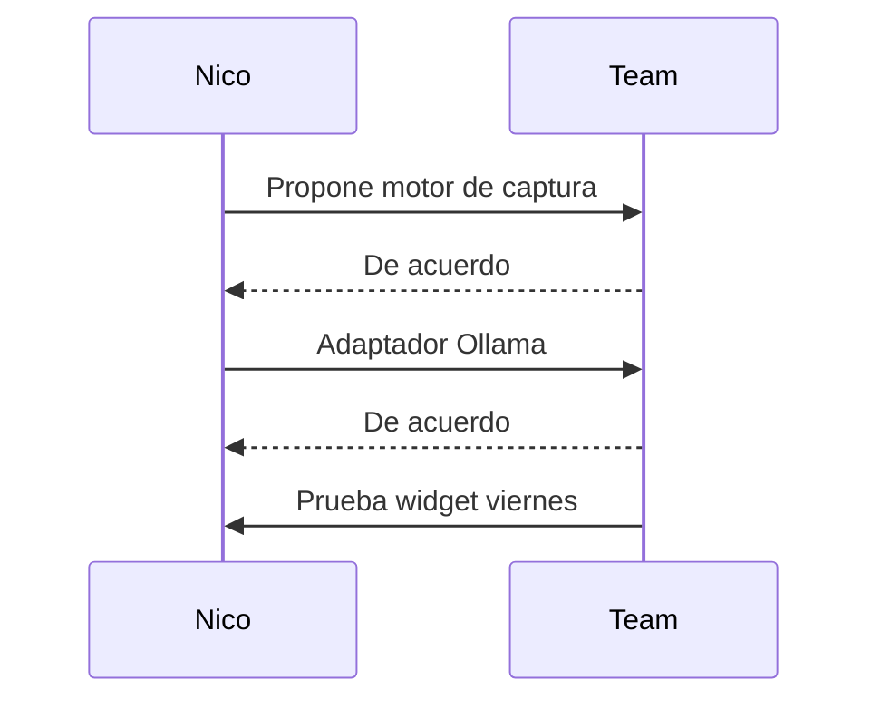

# Meeting notes

## Summary

The team discussed the design of a floating widget for a meeting assistant that records system and microphone audio. They proposed using Whisper for local transcription and Ollama for analysis, with Gemini to be used later. Nico will build the capture engine, and the team agreed to test the widget in the next meeting on Friday.

## Decisions

- Use Whisper for local transcription
- Use Ollama for analysis, with Gemini to be used later
- Nico will build the capture engine
- Test the widget in the next meeting on Friday

## Action items

- [ ] Nico to build the capture engine
- [ ] Implement Whisper for local transcription
- [ ] Implement Ollama for analysis
- [ ] Prepare for testing the widget in the next meeting on Friday

## Sequence diagram



## Architecture diagram

```mermaid

```
